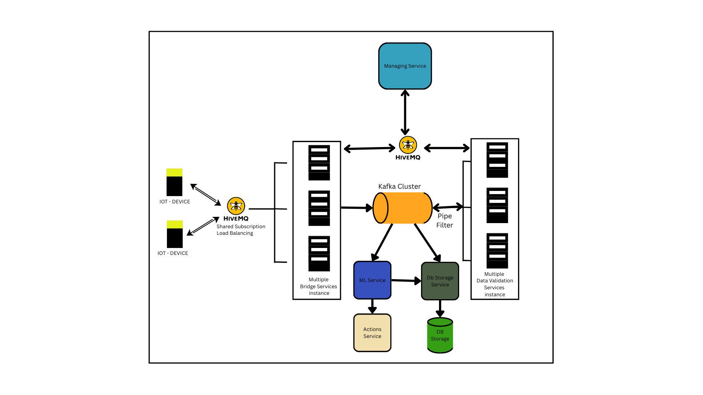

# DataFlow-V2
### Distributed, Event-Driven IoT Data Processing Pipeline

DataFlow-V2 is an enhanced version of my real-time IoT data pipeline, DataFlow-V1. It evolves the original pipeline into a distributed, event-driven architecture using Apache Kafka, Docker, MQTT, and AI-powered analysis.

The primary goal of V2 is to improve scalability, service isolation, fault handling, and the ability to process high-velocity IoT data through independently managed services.

---

## Overview

DataFlow-V2 follows a modular architecture in which data ingestion, stream processing, validation, orchestration, and action handling are separated into individual services.

### Key Features

- **Event-driven architecture:** Uses Apache Kafka as the messaging backbone.
- **MQTT integration:** Receives IoT device data through HiveMQ.
- **Distributed services:** Separates bridge, validation, management, and other responsibilities.
- **Horizontal scaling:** Supports scaling selected services using Docker Compose.
- **Service monitoring:** Manager Service monitors service heartbeats and handles stale service instances.
- **AI integration:** Integrates Google Gemini for anomaly analysis and decision-making.
- **Persistent storage:** Uses Supabase for long-term data storage.
- **Hardware interaction:** Supports sending actions back to IoT devices through MQTT.

---
## High Level System Architechture Diagram

The following diagram illustrates the high-level system architechture of DataFlow-V2 how all services interact.

<p align="center">
  
</p>


## Data Flow Diagram

The following diagram illustrates the high-level journey of data through DataFlow-V2, from IoT device generation to inference, storage, and actions.

<p align="center">
  
</p>

### Data Processing Stages

| Stage | Responsibility |
|---|---|
| Data Generation | IoT devices generate sensor readings. |
| Data Ingestion | HiveMQ receives MQTT messages and Bridge Services ingest the data. |
| Orchestration | Manager Service coordinates service health and lifecycle monitoring. |
| Stream Processing | Kafka provides the event-streaming backbone. |
| Validation | Validation Services process and structure incoming data. |
| Inference & Action | AI-assisted analysis, database storage, and action handling. |

---

## System Architecture

The system is composed of multiple independent services communicating through messaging infrastructure.

> System Architecture Diagram — to be added.

The main components include:

### 1. IoT Devices
Devices generate sensor readings and publish messages through MQTT.

### 2. HiveMQ
Acts as the MQTT broker between IoT devices and the backend ingestion layer.

### 3. Bridge Services
Connect the MQTT ingestion layer to Kafka and handle incoming messages.

Multiple bridge instances can be started to distribute ingestion workloads.

### 4. Apache Kafka
Kafka acts as the central event-streaming backbone, separating ingestion from downstream processing.

This decoupling allows services to consume events independently and supports message replay where the configured retention and consumer setup permit it.

### 5. Manager Service
The Manager Service monitors service health using heartbeats.

It includes a reaper mechanism intended to identify and evict stale service instances.

### 6. Validation Services
Dedicated services handle incoming events and validate or structure data before downstream processing.

### 7. ML Brain
The ML component integrates Google Gemini to analyze processed readings and identify potential anomalies.

Based on the analysis, it can generate alerts or action decisions.

### 8. Storage & Actions
Processed information is persisted in Supabase, while the Actions Service handles the action-processing side of the pipeline, including hardware-related commands.

---

## Technology Stack

| Technology | Purpose |
|---|---|
| Python | Backend services and processing logic |
| Apache Kafka | Event streaming and message distribution |
| MQTT | IoT communication protocol |
| HiveMQ | MQTT broker |
| Google Gemini | AI-powered analysis |
| Docker | Service containerization |
| Docker Compose | Multi-container orchestration |
| Supabase | Persistent database storage |
| REST APIs | Service and database communication |

---

## Running the Project

### Prerequisites

- Docker
- Docker Compose
- Python (for local development, if required)
- HiveMQ MQTT broker access
- Supabase project and credentials
- Google Gemini API key

### 1. Clone the repository

```bash
git clone https://github.com/SnapTexas/DataFlowV2.git
cd DataFlowV2
```

### 2. Configure environment variables

Configure the required credentials and service settings using the environment configuration expected by the individual services.

Typical configuration includes:

```env
GEMINI_API_KEY=your_gemini_api_key
SUPABASE_URL=your_supabase_url
SUPABASE_KEY=your_supabase_key
MQTT_BROKER=your_mqtt_broker
```

Use the actual variable names required by the project configuration.

**Important:** Never commit API keys, database credentials, or other secrets to GitHub.

### 3. Start the services

Build and start the Docker Compose environment:

```bash
docker compose up -d --build
```

### 4. Scale Bridge Services

Multiple bridge instances can be started using:

```bash
docker compose up -d --scale bridge=3
```

This starts three bridge instances, assuming the Compose service is named `bridge` and its configuration supports scaling.

### 5. Monitor containers

```bash
docker compose ps
```

View service logs:

```bash
docker compose logs -f
```

---

## Fault Handling & Scalability

One of the main design goals of V2 is to reduce dependency between individual services.

### Service Health Monitoring

The Manager Service uses heartbeat monitoring to track service health.

The reaper mechanism is designed to identify stale instances and remove them from active service management.

### Kafka-Based Messaging

Kafka separates message ingestion from downstream processing.

This provides:

- Decoupled producers and consumers.
- Message retention and replay capabilities.
- Independent consumer processing.
- Better support for distributed workloads.

### Horizontal Scaling

Selected services can be scaled independently using Docker Compose, allowing additional processing instances to be started without redesigning the entire pipeline.

---

## DataFlow-V1 vs DataFlow-V2

| Area | DataFlow-V1 | DataFlow-V2 |
|---|---|---|
| Messaging backbone | Redis | Apache Kafka |
| Architecture | Simpler, more centralized pipeline | Distributed, event-driven services |
| Processing | Validation pipeline | Separated ingestion and validation services |
| Deployment | Less container-oriented | Docker-based multi-service setup |
| Service monitoring | Limited | Dedicated Manager Service |
| AI integration | Gemini-assisted dashboard | Dedicated ML analysis component |
| Scalability | More limited | Independent service scaling |

V2 builds on the original proof of concept by introducing a more modular and distributed processing design.

---

## Development Status

DataFlow-V2 is an evolving engineering project. Some components and reliability mechanisms are still being tested and improved.

Areas of ongoing development include:

- Improving service coordination and recovery.
- Testing multiple service instances under load.
- Strengthening message-processing reliability.
- Improving validation and error handling.
- Expanding AI-assisted inference and hardware actions.
- Improving deployment and configuration management.

---

## What I Learned

Building DataFlow-V2 helped me explore and work with:

- Distributed systems and event-driven architecture.
- Apache Kafka and message streaming.
- MQTT-based IoT communication.
- Containerization and multi-service deployment.
- Service health monitoring and lifecycle management.
- Backend service design and integration.
- AI-assisted anomaly analysis and automation.

The project represents my progression from building a functional IoT pipeline in V1 to exploring distributed backend architecture in V2.

---

## Author

**Shahid Shaikh (SnapTexas)**

- GitHub: [@SnapTexas](https://github.com/SnapTexas)
- Project Repository: [DataFlow-V2](https://github.com/SnapTexas/DataFlowV2)

